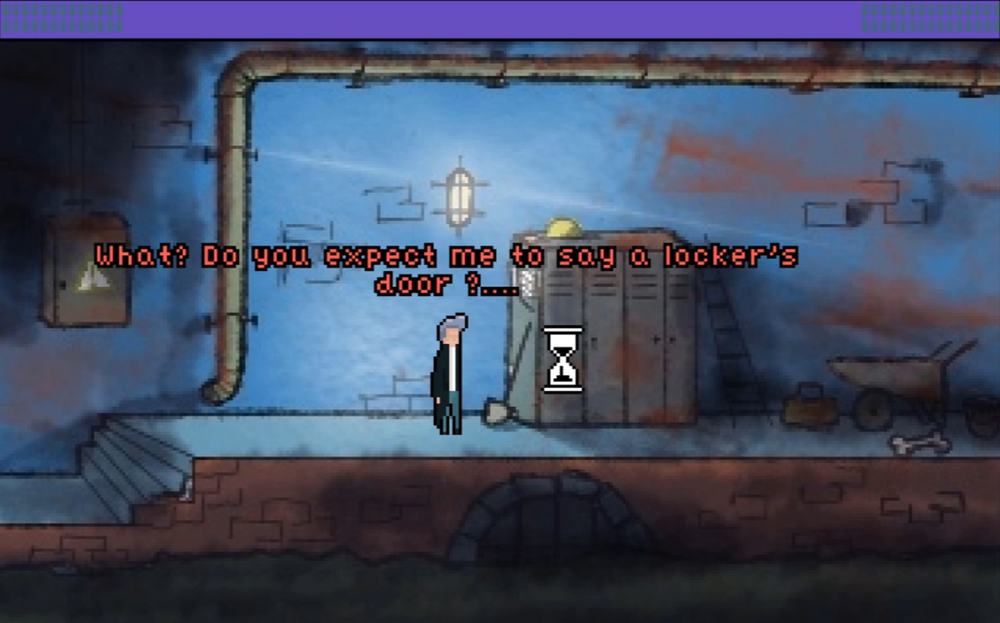

# Jack the Ripper: A New Beginning

**University Project · 2019 · Adventure Game Studio**

A short dark-comedy point-and-click adventure created during my university studies in London.

## Links

- [Play on itch.io](https://hollow-707.itch.io/jack-the-ripper-a-new-beginning)
- [Portfolio Case Study](https://dany.mind-software.ro/pages/project.html?id=jack-the-ripper)
- [Gameplay Video](https://www.youtube.com/watch?v=incz7JBKngk8)

## About

**Jack the Ripper: A New Beginning** is a 2019 university game-development project built in Adventure Game Studio.

The game is a short point-and-click adventure set in a dark-comedy interpretation of Victorian London. The player follows Jack through a surreal sequence of environmental puzzles, dialogue, inventory interactions and increasingly strange encounters involving Bart the Skeleton and The Mighty Toaster.

The project was inspired by classic LucasArts adventure games such as:

- Monkey Island
- Day of the Tentacle
- Sam & Max Hit the Road

## My Role

This was a solo project.

I was responsible for:

- Game Design
- Narrative Design
- Puzzle Design
- Gameplay Scripting
- Dialogue Writing
- Cutscene Implementation
- Environment Art
- Inventory Item Art
- Audio & Atmosphere Implementation

## Project Highlights

- Developed in Adventure Game Studio
- Four hand-drawn environment backgrounds
- Classic point-and-click interaction system
- Dialogue trees and dark-comedy writing
- Multi-room inventory puzzle chain
- Custom intro and ending cutscenes
- Save / Load / Restart systems
- Inventory and GUI implementation
- Environmental storytelling
- Hand-drawn item artwork

## Core Interactions

The game uses classic adventure-game interactions:

- Walk
- Look
- Interact
- Talk
- Pick Up
- Use Inventory

## Puzzle Design

The main progression is built around finding and combining items across multiple rooms.

One of the central puzzle chains is:

**Key → Locker → Rune Board → Spear → Spider Web → Rune Cipher → Decoded Note → Vault Door**

The player must revisit earlier rooms with newly acquired items rather than solving every puzzle in a single location.

## Art

All four main environment backgrounds were drawn by me on a tablet.

This was my first serious attempt at digital environment art.

The environments include:

- Dark Alley
- Sewers
- Storage Area
- The Office

I also created the inventory-item artwork used throughout the game.

Character sprites were sourced from third-party asset packs and are credited in the project documentation.

## Audio & Atmosphere

The project uses different audio moods for each major area:

- Dark Alley — relaxed jazz-inspired music intended to suggest late-night London
- Sewers — environmental ambience with dripping water, echoes and underground atmosphere
- The Office — more dramatic and melancholic music to build tension before the final reveal

Some audio assets were sourced externally and are not included in this repository.

## Development Notes

This repository contains the original editable AGS project source.

Generated builds, debug files and cached audio have been excluded.

The project includes:

- `Game.agf`
- AGS room files
- Global scripts
- Dialogue and interaction logic
- Sprite data
- Fonts
- UI / GUI configuration

## Reflection

This project was an important learning experience for me because it was my first complete game and my first time combining:

- environment art
- gameplay scripting
- puzzle design
- dialogue
- inventory systems
- cutscenes
- audio design

Looking back, there are several areas I would improve today:

- some puzzles are too simple
- some item and dialogue interactions can be repeated unnecessarily
- inventory spacing is too tight
- the scripting workflow was inconsistent
- playtesting was informal and not documented

These limitations are part of why I still find the project valuable to revisit, as they show how much my design process has evolved since 2019.

## Author

**Smeu Daniel Alexandru**  
Game Designer

## Copyright

© Smeu Daniel Alexandru. All rights reserved.

This repository is provided for portfolio, review and evaluation purposes.

No permission is granted to redistribute, republish, reuse or sell my original artwork, design documentation, code or project materials without explicit permission.